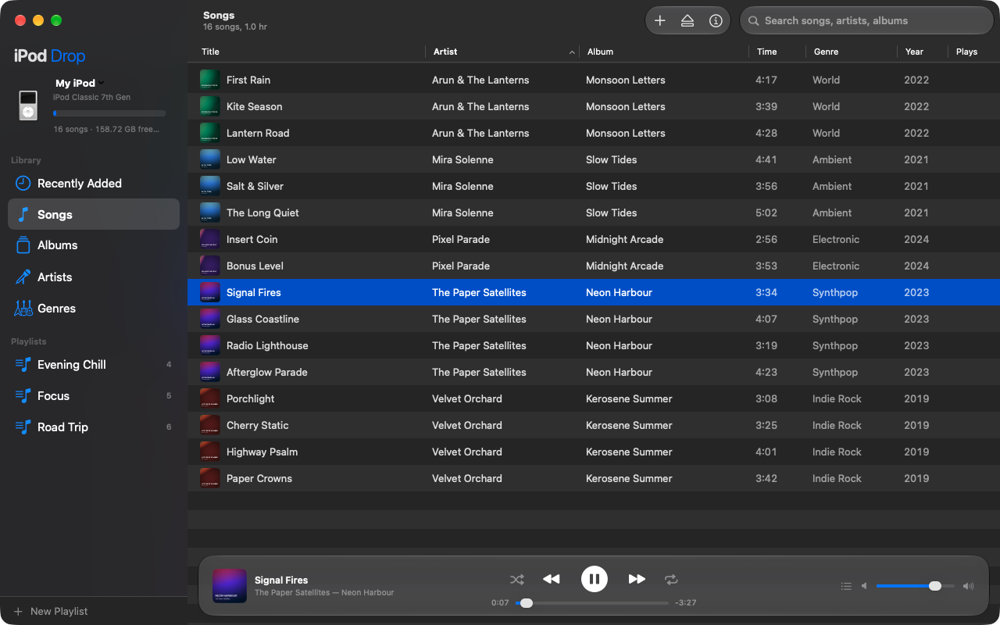
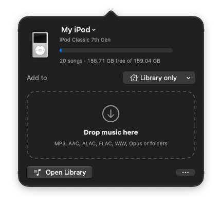
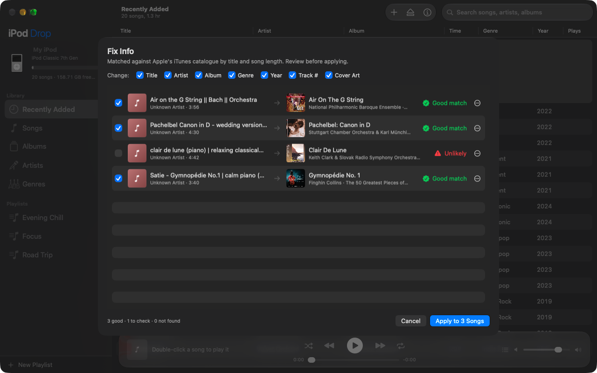
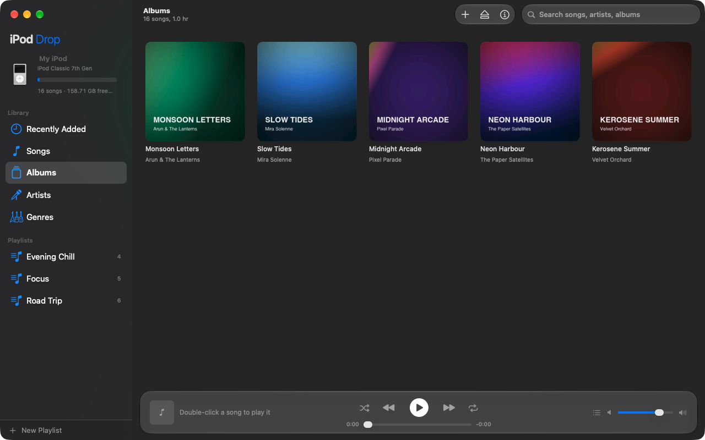

# iPod Drop

**Drag and drop music onto your classic iPod from macOS, no iTunes needed.**

iPod Drop is a native macOS app for click-wheel iPods. Drop songs on the menu bar icon (or into the library window) and they're converted if needed and written to your iPod's library, with playlists, cover art and correct song info.

**[Download for macOS](https://abijitinu.github.io/ipod-drop/)** · [Releases](https://github.com/abijitinu/ipod-drop/releases)



## Screenshots

*Screenshots use a demo library with made-up artists and silent tracks.*

### Drop music from the menu bar

iPod Drop sits in the macOS menu bar. Drag songs or folders onto the iPod icon to send them straight to your iPod, into any playlist, without opening a window. The popover shows the connected iPod, its free space and where the music will go.

<p align="center"></p>

### Grab song info and cover art (Fix Info)

Right-click songs and choose **Fix Info** to grab metadata from Apple's iTunes catalogue: title, artist, album, genre, year, track number and cover art. Matches are scored by title and song length; good matches are pre-ticked, doubtful ones are flagged, and nothing changes until you apply.



### Browse your iPod



## Features

- **Menu bar drop**: drag music onto the iPod icon in the menu bar (or into the library window, or choose files and folders) and pick the playlist it goes into.
- **Any audio format**: MP3, AAC and Apple Lossless go straight on; FLAC, WAV, AIFF, Opus, OGG and others are converted automatically (lossless to Apple Lossless, lossy to 256 kbps AAC).
- **Manage your iPod**: browse songs, albums, artists and genres; create, rename and delete playlists; edit song info and ratings; remove songs.
- **Fix Info (grab metadata)**: look songs up in Apple's iTunes catalogue to fix titles, artists, albums, genres, years, track numbers and cover art, with a review step before anything changes. Run it on a few songs or the whole library (File › Fix Info for All Songs…, ⇧⌘I): fill in only what's missing or replace everything; songs from one album are matched together.
- **Built-in player**: play songs straight from the iPod, with Up Next, shuffle, repeat and media keys.
- **Several iPods**: switch between connected iPods; each is shown with a photo of its exact model.
- **Safe writes**: only one program writes to the iPod at a time, and duplicates are skipped.
- **Live progress**: adds, edits and deletes show the song being worked on, how many files are done of the total and the percentage, with an iTunes-style moving striped bar.
- **Automatic updates**: iPod Drop checks for new versions once a day (or iPod Drop › Check for Updates…) and installs them when you say so. Updates are signed, so only genuine releases install.
- **Recovers interrupted saves**: if saving to the iPod was cut off (unplugged, crashed), iPod Drop offers to restore the previous library or keep what's there.
- **Error reports**: Help › Send Error Report… opens an email to the developer with your Mac, iPod and app details and the app's log attached. Nothing is sent until you press Send.

## Supported iPods

| iPod | Status |
|---|---|
| iPod classic (6th, 6.5th, 7th generation) | ✅ Tested on a real iPod classic and on simulated ones |
| iPod (3rd generation), iPod photo (4th), iPod video (5th, 5.5th) | ✅ Tested on simulated iPods |
| iPod mini (1st, 2nd generation) | ✅ Tested on simulated iPods |
| iPod nano (1st to 4th generation) | ✅ Tested on simulated iPods |
| iPod nano (5th generation) | ⚠️ Should work once the iPod has been synced with iTunes/Finder at least once (it needs signing data they leave behind); not yet tested |
| iPod nano (6th, 7th generation) | ⚠️ Detected and shown; writing not yet tested on hardware |
| iPod shuffle, iPod touch | ❌ Not supported |

Both Mac-formatted and Windows-formatted iPods work. If an iPod only charges and doesn't show up as a disk, iPod Drop explains how to put it into Disk Mode.

**Known limitation:** an older iPod whose library was last written by gtkpod, Rhythmbox or Strawberry may be refused, because its library uses a layout that can't be extended without losing data. iPod Drop says so clearly; restoring the iPod with Finder fixes it (back up its music first).

## Install

1. Download `iPod-Drop.dmg` from the [website](https://abijitinu.github.io/ipod-drop/) or [Releases](https://github.com/abijitinu/ipod-drop/releases), open it and drag **iPod Drop** to **Applications**.
2. The app isn't notarized by Apple yet, so the first time you open it macOS will block it. Open **System Settings › Privacy & Security**, scroll down and click **Open Anyway**.
3. Install [ffmpeg](https://ffmpeg.org) for format conversion: `brew install ffmpeg` (with [Homebrew](https://brew.sh)).

After that, iPod Drop keeps itself up to date: it checks once a day and asks before installing (iPod Drop › Check for Updates… checks now). Versions before 2.3 can't update themselves, so download 2.3 once by hand.

Requires **macOS 14 Sonoma or later** (Sonoma, Sequoia, Tahoe and newer) on Apple silicon. On macOS 26 and later the app uses the Liquid Glass look; on Sonoma and Sequoia it uses the standard macOS look.

## Build from source

You need Xcode 26 (the app still runs on macOS 14 Sonoma and later), [uv](https://docs.astral.sh/uv/), [XcodeGen](https://github.com/yonaskolb/XcodeGen) and ffmpeg:

```bash
brew install xcodegen ffmpeg uv
uv venv --python 3.12 .venv
uv pip install --python .venv/bin/python -r requirements.txt
tools/build_app.sh --install      # builds iPod Drop.app with its engine bundled
tools/build_app.sh --dmg          # also packages build/iPod-Drop.dmg
tools/make_update.sh              # signed update zip + docs/appcast.xml for in-app updates
```

`xcodegen generate` creates `iPodDrop.xcodeproj` from `project.yml` if you want to work in Xcode.

### How it's built

- `iPodDrop/`: the SwiftUI app (menu bar drop target, library window, player, Fix Info).
- `ipod_engine/`: a small Python helper that drives [iOpenPod](https://github.com/TheRealSavi/iOpenPod)'s library engine over JSON-RPC. It is the only part that reads and writes the iPod.
- `tools/`: build and publish scripts (`make_update.sh` signs the update with the key in the maintainer's Keychain and writes the update feed `docs/appcast.xml`), `make_demo_library.py` (the fictional demo library used for screenshots), plus end-to-end tests. `engine_write_test.py` runs against a connected iPod; `engine_bulk_test.py` checks bulk add, edit, cover art, playlist and delete operations (and their progress) on a simulated iPod; `virtual_ipod.py` and `model_matrix.sh` test other models using disk images made to look like freshly restored iPods. Back up your iPod before running tests that write.

## Credits

- [iOpenPod](https://github.com/TheRealSavi/iOpenPod) by John Gibbons and contributors: the iPod database engine (GPL-3.0).
- [HashAB](https://github.com/dstaley/hashab) by Dylan Staley, used by iOpenPod for newer iPod nanos.
- [libgpod](https://sourceforge.net/projects/gtkpod/) for creating the simulated iPods used in testing.
- Song info and cover art in Fix Info come from Apple's iTunes Search API.

## License

GPL-3.0. See [LICENSE](LICENSE). Because iPod Drop is built on iOpenPod (GPL-3.0), the whole app is released under the same license.

iPod Drop is an independent project and is not affiliated with, endorsed by, or sponsored by Apple Inc. iPod, iTunes, Finder and macOS are trademarks of Apple Inc.
